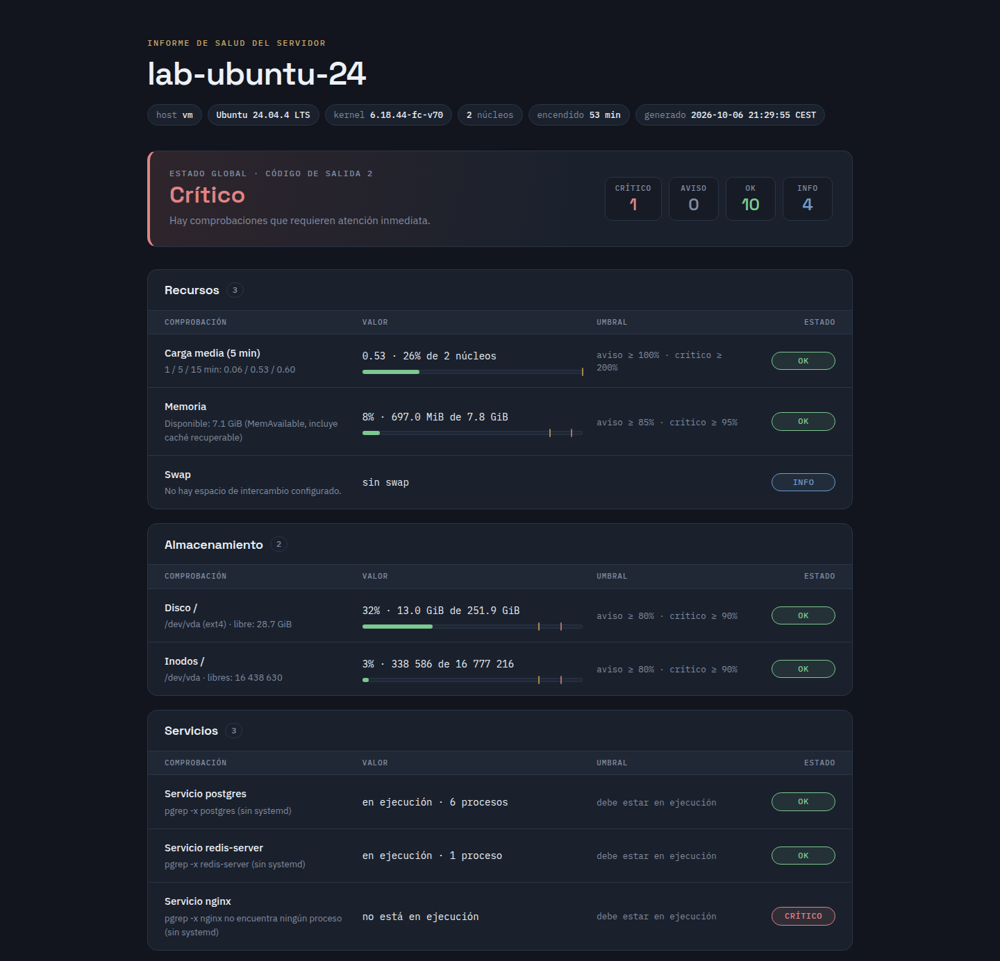

# sysadmin-toolkit

Cuatro scripts en Bash para tareas habituales de administración de sistemas Linux: comprobar la salud de un servidor, hacer copias de seguridad con retención, dar de alta usuarios en bloque desde un CSV y hacer inventario de una red. Están escritos para que sean seguros por defecto y fáciles de leer y de mantener: `set -Eeuo pipefail`, validación de todas las entradas, modo simulación antes de cambiar nada, bloqueo contra ejecuciones simultáneas, ShellCheck sin avisos y 91 pruebas automáticas con [bats](https://github.com/bats-core/bats-core). Los comentarios y las ayudas (`--help`) están en español.



*Informe HTML real generado por `healthcheck.sh` en el contenedor de pruebas ([HTML](docs/informe-ejemplo.html) · [JSON](docs/informe-ejemplo.json)). El estado crítico es real: nginx estaba configurado en `--servicios` pero no estaba en marcha. Los montajes de `/opt`, propios de las herramientas del contenedor, se excluyeron con `--excluir-montaje '/opt/*'`.*

## Scripts

| Script | Qué hace | Códigos de salida |
|---|---|---|
| [`bin/healthcheck.sh`](bin/healthcheck.sh) | Salud del servidor: carga, memoria, swap, discos e inodos, servicios, puertos en escucha, tiempo encendido, reinicio pendiente y fallos de SSH. Resumen en terminal, JSON, HTML o línea para Nagios. | 0 OK · 1 WARNING · 2 CRITICAL · 3 UNKNOWN |
| [`bin/backup.sh`](bin/backup.sh) | Copias `tar.gz` con fecha, exclusiones, suma SHA-256, verificación, retención diaria/semanal, bloqueo con `flock` y `--dry-run`. | 0 bien · 1 error · 2 uso · 3 otra copia en curso |
| [`bin/alta-usuarios.sh`](bin/alta-usuarios.sh) | Alta masiva de usuarios desde un CSV. Sin `--aplicar` solo muestra el plan. Contraseñas temporales aleatorias y cambio obligatorio en el primer acceso. | 0 bien · 1 fallo al aplicar · 2 uso · 3 CSV con errores · 4 falta root |
| [`bin/escaneo-red.sh`](bin/escaneo-red.sh) | Inventario de una red IPv4 (hasta /22): hosts activos con ping en paralelo, DNS inverso y puertos TCP abiertos. Tabla o CSV. Si no hay ICMP, detecta por TCP. | 0 bien · 1 error · 2 uso |

Todos admiten `-h/--help`, `--version`, `-q/--quiet` y `-v/--verbose`. Los colores solo se usan si la salida es una terminal y `NO_COLOR` no está definida. Los mensajes van a la salida de error y los resultados a la salida estándar, así que se pueden redirigir sin mezclarse.

## Requisitos y compatibilidad

- **Bash 4.4 o posterior** (arrays asociativos, `wait -n`, `mapfile`, `{fd}>`).
- **GNU coreutils** (`df --output`, `date -d`, `realpath`, `stat -c`), `tar` y `gzip`, `flock` (util-linux), `pgrep` (procps), `getent`, `timeout`.
- `alta-usuarios.sh` con `--aplicar`: `useradd`, `groupadd`, `chpasswd` y `chage` (paquete shadow / passwd).
- Opcionales: **systemd** (si no está, los servicios se comprueban con `pgrep -x`), **ss** de iproute2 (si no está, los puertos se leen de `/proc/net/tcp`), **ping** de iputils (si no está o no está permitido, la detección de hosts se hace por TCP).

**Dónde se ha probado:** Ubuntu 24.04.4 LTS con Bash 5.2.21, en un contenedor sin systemd y sin `ss`, como root. Ahí se han ejecutado todas las pruebas y se han generado las salidas de [`docs/`](docs/). Las rutas pensadas para la familia Red Hat (`/var/log/secure`, `needs-restarting -r`) están en el código pero no se han probado en esas distribuciones.

## Instalación

```bash
sudo git clone https://github.com/miguelAV33/sysadmin-toolkit.git /opt/sysadmin-toolkit
# Opcional: enlaces en el PATH. Los scripts resuelven su ruta real con
# readlink -f, así que encuentran lib/ aunque se llamen desde el enlace.
sudo ln -s /opt/sysadmin-toolkit/bin/healthcheck.sh /usr/local/sbin/healthcheck
sudo ln -s /opt/sysadmin-toolkit/bin/backup.sh /usr/local/sbin/backup
```

## healthcheck.sh — salud del servidor

```bash
# Resumen en la terminal con los umbrales por defecto
bin/healthcheck.sh

# Servicios y puertos que deben estar activos, umbrales de disco propios
bin/healthcheck.sh --servicios "ssh,cron,nginx" --puertos-esperados 22,80,443 \
  --disk-warn 75 --disk-crit 90

# Desde un fichero de configuración, sin salida en pantalla, publicando informes
bin/healthcheck.sh -c /etc/sysadmin-toolkit/healthcheck.conf --quiet \
  --html /var/www/estado/index.html --json /var/lib/healthcheck/ultimo.json

# Nombre a mostrar en el informe en lugar del nombre del host
bin/healthcheck.sh --etiqueta "web-01 (producción)" --html informe.html
```

**Comprobaciones**

| Comprobación | Cómo se mide | Umbral por defecto (aviso / crítico) |
|---|---|---|
| Carga media | Carga de 5 min de `/proc/loadavg` en % del número de núcleos | 100 % / 200 % (`--load-warn/--load-crit`) |
| Memoria | `(MemTotal - MemAvailable) / MemTotal`: la caché recuperable no cuenta como usada | 85 % / 95 % (`--mem-warn/--mem-crit`) |
| Swap | `SwapTotal - SwapFree`; si no hay swap se indica como informativo | 50 % / 80 % (`--swap-warn/--swap-crit`) |
| Disco e inodos | `df --local` de cada sistema de ficheros real. Se ignoran tmpfs, overlay, squashfs, FUSE, etc., salvo la raíz `/`, que se revisa siempre (en un contenedor suele ser overlay) | 80 % / 90 % (`--disk-*`, `--inode-*`) |
| Servicios | `systemctl is-active` si hay systemd; si no, `pgrep -x` | crítico si no está activo |
| Puertos TCP | `ss -ltn` o, sin `ss`, `/proc/net/tcp` y `/proc/net/tcp6`; agrupados por dirección | crítico si falta un puerto de `--puertos-esperados` |
| Tiempo encendido | `/proc/uptime` | informativo |
| Reinicio pendiente | `/var/run/reboot-required` (Debian/Ubuntu) o `needs-restarting -r` (RHEL) | aviso |
| Fallos de SSH | Líneas `Failed password` / `Invalid user` de sshd en `/var/log/auth.log` o `/var/log/secure` (log actual, desde su última rotación), con las IP que más fallan | 20 / 100 (`--ssh-warn/--ssh-crit`) |

Si el log de autenticación no se puede leer (hace falta root o el grupo `adm`), la comprobación aparece como informativa y no cambia el estado global.

**Códigos de salida (convención de Nagios / Icinga)**

| Código | Estado | Cuándo |
|---|---|---|
| 0 | OK | Todas las comprobaciones están dentro de los umbrales |
| 1 | WARNING | Hay al menos un aviso y ningún crítico |
| 2 | CRITICAL | Hay al menos una comprobación crítica |
| 3 | UNKNOWN | Error de uso, fallo inesperado del script, o alguna comprobación no se pudo hacer (y no hay avisos ni críticos) |

Prioridad: CRITICAL > WARNING > UNKNOWN > OK. Un error de uso sale con 3 y no con 1 para que el sistema de monitorización no lo muestre como un WARNING.

**Fichero de configuración.** [`ejemplos/healthcheck.conf`](ejemplos/healthcheck.conf) recoge todas las claves (`DISCO_AVISO=80`, `SERVICIOS="ssh,cron"`...). El fichero se analiza línea a línea y solo se aceptan claves conocidas: nunca se ejecuta con `source`, así que no puede colar código. Las opciones de la línea de comandos tienen prioridad sobre el fichero.

**Desde cron.** Con `--quiet` no imprime nada; cron solo manda correo cuando hay salida, así que el `echo` hace que avise únicamente si el estado no es OK:

```cron
*/15 * * * * /opt/sysadmin-toolkit/bin/healthcheck.sh -q -c /etc/sysadmin-toolkit/healthcheck.conf --html /var/www/estado/index.html || echo "healthcheck en $(hostname): código $?"
```

**Desde Nagios / Icinga (NRPE).** `--nagios` imprime una sola línea con datos de rendimiento para las gráficas:

```text
$ bin/healthcheck.sh --nagios --servicios postgres,redis-server,nginx --puertos-esperados 5432,6379,8080 --excluir-montaje '/opt/*'
HEALTHCHECK CRITICAL - Servicio nginx: no está en ejecución | 'Carga media (5 min)'=26%;100;200;0;100 'Memoria'=8%;85;95;0;100 'Disco /'=32%;80;90;0;100 'Inodos /'=3%;80;90;0;100
```

```ini
# /etc/nagios/nrpe.d/sysadmin-toolkit.cfg
command[check_salud]=/opt/sysadmin-toolkit/bin/healthcheck.sh --nagios -c /etc/sysadmin-toolkit/healthcheck.conf
```

Más detalle en [`ejemplos/nrpe.cfg`](ejemplos/nrpe.cfg).

**Informes.** `--json FICHERO` guarda el estado global, el resumen y cada comprobación (estado, valor, porcentaje, umbrales y detalle). `--html FICHERO` genera un documento autocontenido (CSS dentro del propio fichero, sin JavaScript); la única petición externa son las fuentes de Google Fonts, con fuentes del sistema como alternativa. Todo valor que se inserta en el JSON o en el HTML pasa antes por una función de escapado. Los dos ficheros se escriben de forma atómica (temporal + `mv`), así que un servidor web nunca sirve un informe a medias.

## backup.sh — copias de seguridad

```bash
# Ver qué haría, sin escribir ni borrar nada
bin/backup.sh --dry-run -d /srv/backups -n web /var/www /etc/nginx

# Copia real, excluyendo logs y cachés, con log propio
bin/backup.sh -d /srv/backups -n web -e '*.log' -e 'cache' \
  --log /var/log/backup-web.log /var/www /etc/nginx

# Retención personalizada: 14 diarias y 8 semanales
bin/backup.sh -d /srv/backups -n etc --keep-daily 14 --keep-weekly 8 /etc
```

Cada copia se llama `PREFIJO_AAAA-MM-DD_HHMMSS.tar.gz` y lleva al lado su `PREFIJO_...tar.gz.sha256`. El proceso es:

1. Toma un bloqueo con `flock` sobre `DESTINO/.PREFIJO.lock`. Si otra copia con el mismo destino y prefijo sigue en marcha, sale con código 3. El kernel libera el bloqueo aunque el proceso muera de golpe.
2. Crea el archivo como `.part`. Si el script se interrumpe (error, Ctrl+C, `kill`), la trampa `EXIT` detiene `tar` y borra el `.part`. `tar` se lanza en segundo plano y se espera con `wait`: así la señal se atiende al momento, sin esperar a que `tar` termine (con un comando en primer plano, Bash no ejecuta la trampa hasta que el comando acaba).
3. Lo verifica leyéndolo entero con `tar --list` (comprueba el CRC de gzip y la estructura de tar).
4. Solo entonces lo renombra a su nombre definitivo y escribe la suma SHA-256.
5. Aplica la retención.

Las rutas se guardan relativas a `/` (`etc/nginx/...`). Si el destino está dentro de un origen, se excluye solo. Los archivos se crean con `umask 077` (permisos 600) porque pueden contener datos sensibles.

**Retención.** Hay dos reglas independientes. Una copia se conserva si la elige al menos una de ellas, y el resto de copias **de ese prefijo** se borran (junto con su `.sha256`):

- `--keep-daily N` (7 por defecto, mínimo 1): de los N días más recientes que tienen copias, se conserva la copia más reciente de cada día.
- `--keep-weekly N` (4 por defecto): de las N semanas ISO más recientes (de lunes a domingo) que tienen copias, se conserva la copia más reciente de cada semana.

La fecha se toma del nombre del fichero, no de la fecha de modificación, así que copiar las copias a otro disco no altera la retención. Si se hacen varias copias el mismo día, la regla diaria solo conserva la última de ese día. Los ficheros que no siguen el patrón exacto `PREFIJO_AAAA-MM-DD_HHMMSS.tar.gz` no se tocan nunca.

Ejemplo (el de las pruebas): copias del 1 al 20 de enero de 2026, dos el día 20, más la de hoy, con `--keep-daily 3 --keep-weekly 3`. Se conservan la de hoy, la del 20 a las 23:00 y la del 19 (diarias) y la del domingo 18 (última de la semana ISO 3); las otras 18 se borran.

**Restaurar y verificar:**

```bash
cd /srv/backups && sha256sum -c web_2026-10-06_031500.tar.gz.sha256
tar -tzf web_2026-10-06_031500.tar.gz | less                 # ver el contenido
tar -xzf web_2026-10-06_031500.tar.gz -C /tmp/restauracion   # restaurar en otra ruta
```

**Desde cron:**

```cron
15 3 * * * /opt/sysadmin-toolkit/bin/backup.sh -q -d /srv/backups -n web --log /var/log/backup-web.log /etc /var/www
```

## alta-usuarios.sh — alta masiva de usuarios

Formato del CSV ([`ejemplos/usuarios.csv`](ejemplos/usuarios.csv)), con cabecera:

```csv
usuario,nombre_completo,grupo,shell
lgarcia,Lucía García Romero,desarrollo,/bin/bash
mlopez,María López Díaz,soporte,/usr/bin/dash
```

```bash
# Sin --aplicar: solo muestra el plan; no hace falta ser root
bin/alta-usuarios.sh ejemplos/usuarios.csv

# Aplicar de verdad (root), guardando las credenciales en una ruta concreta
sudo bin/alta-usuarios.sh --aplicar --credenciales /root/altas-octubre.csv ejemplos/usuarios.csv
```

**Validaciones de cada fila.** Exactamente 4 campos. Usuario y grupo según la convención de `useradd` (`^[a-z_][a-z0-9_-]{0,31}$`). Nombre completo no vacío y sin `:`, porque es el separador de `/etc/passwd`. Shell incluida en `/etc/shells` y ejecutable. Sin usuarios repetidos dentro del CSV. Los usuarios que ya existen en el sistema se **omiten con un aviso**. Se aceptan ficheros con finales de línea de Windows y con BOM, como los que exporta Excel. Si **alguna** fila tiene errores, el script sale con 3 y no aplica nada, ni siquiera las filas correctas. [`ejemplos/usuarios-con-errores.csv`](ejemplos/usuarios-con-errores.csv) muestra todos los casos.

**Al aplicar:**

- Comprueba que se ejecuta como root antes de hacer nada (si no, sale con 4).
- Crea primero el fichero de credenciales con permisos 600 y sin sobrescribir uno existente. Si no se puede crear, no da de alta a nadie.
- Crea los grupos que falten (`groupadd`).
- Crea cada usuario con su directorio personal y el grupo del CSV como grupo principal (`useradd --create-home --gid`).
- Genera una contraseña temporal de 16 caracteres a partir de `/dev/urandom`, sin caracteres que se confunden al leerlos (0/O, 1/l/I), y la asigna con `chpasswd` por la entrada estándar: nunca aparece como argumento visible con `ps`.
- Obliga a cambiarla en el primer inicio de sesión (`chage --lastday 0`).

## escaneo-red.sh — inventario de red

```bash
# Hosts activos de una /24
bin/escaneo-red.sh 192.168.1.0/24

# Con puertos concretos y rangos
bin/escaneo-red.sh -p 22,80,443,8000-8010 192.168.1.0/24

# CSV para una hoja de cálculo
bin/escaneo-red.sh --csv -p 22,3389 10.0.0.0/23 > inventario.csv

# Sin ICMP (cortafuegos que bloquea ping): detección solo por TCP
bin/escaneo-red.sh --sin-ping -p 22,443 10.0.0.0/28
```

- El rango se valida: notación CIDR, octetos de 0 a 255 sin ceros a la izquierda (en Bash `010` sería octal) y prefijo entre /22 (1024 direcciones) y /32. Si la IP no es la dirección de red, se normaliza y se avisa.
- Se lanzan como mucho `-j N` sondeos a la vez (32 por defecto) con trabajos en segundo plano y `wait -n`. Cada sondeo escribe su propio fichero temporal, así que los resultados no se mezclan y salen ordenados por IP.
- Los puertos se comprueban con `/dev/tcp` de Bash dentro de `timeout`. La IP y el puerto se pasan como argumentos y no dentro del texto del comando.
- **Sin ping:** si `ping` no está instalado o no tiene permiso (por ejemplo, contenedores sin `CAP_NET_RAW`), el script lo dice y detecta los hosts por TCP. Un host cuenta como activo si acepta la conexión o la rechaza activamente con RST (`Connection refused`). Si no se indican puertos, usa 22, 80, 443, 445 y 3389.
- El nombre se obtiene con `getent hosts`, que respeta `/etc/hosts` y `nsswitch.conf` (`--sin-dns` lo desactiva).

Escanea solo redes que administres o para las que tengas autorización.

## Decisiones de seguridad y robustez

- **`set -Eeuo pipefail` en todos los scripts** y una trampa `ERR` común que indica fichero, línea y comando si algo falla sin estar previsto. Las funciones que devuelven verdadero/falso se usan en `if`, y los comandos que pueden «fallar» con normalidad (`grep` sin coincidencias, `pgrep` sin procesos) llevan su `|| true` comentado.
- **Simulación por defecto donde se cambia el sistema:** `alta-usuarios.sh` no toca nada sin `--aplicar`. `backup.sh --dry-run` no escribe ni borra nada, ni siquiera el log.
- **Validación de todas las entradas** antes de actuar: porcentajes, puertos, rangos CIDR, prefijos de nombre de fichero, nombres de usuario y servicio, filas del CSV. Un error de uso nunca deja el sistema a medias.
- **Comillas en todas las expansiones** y **arrays** para construir comandos con argumentos variables (`tar`, exclusiones), así que los espacios en las rutas no rompen nada.
- **Escritura atómica:** informes en un temporal + `mv`; copias de seguridad como `.part` hasta verificarlas.
- **Bloqueo con `flock`** en las copias para evitar dos ejecuciones simultáneas sobre el mismo destino.
- **Señales:** `trap 'exit 130' INT` y `trap 'exit 143' TERM` hacen que también se ejecute la limpieza (`trap EXIT`) cuando se cancela un script. Los procesos largos (`tar`) se esperan con `wait` para que la cancelación sea inmediata.
- **Permisos mínimos:** copias con `umask 077`; credenciales con 600 y sin sobrescribir; root solo cuando se aplica el alta.
- **Configuración que no se ejecuta:** el fichero de `healthcheck.sh` se analiza, no se carga con `source`.
- **Escapado de todo dato externo** en JSON, HTML y CSV. Las sustituciones de `escapar_html` van entre comillas porque en Bash 5.2 un `&` sin comillas en `${var//patrón/&amp;}` equivale al texto encontrado (`patsub_replacement`). Hay una prueba para ese caso.
- **Detalles de `pipefail`:** no se usan tuberías del tipo `cmd | head` (que pueden fallar por SIGPIPE con `pipefail`). Las contraseñas se generan con `head -c 256 /dev/urandom | tr -dc ...`, que siempre lee un bloque fijo.
- **Configuración regional predecible:** `LC_ALL=C.UTF-8` para analizar la salida de los comandos en formato C y contar bien los caracteres con tilde al alinear tablas.
- **Aritmética sin sorpresas:** `x=$(( x + 1 ))` en vez de `(( x++ ))`, que con `set -e` termina el script cuando `x` vale 0; y nada de ceros a la izquierda, que Bash leería en octal.

## Pruebas

```bash
make lint          # ShellCheck sobre bin/, lib/ y tests/
make test          # pruebas con bats (sin efectos en el sistema)
make herramientas  # si no tienes bats: lo instala en .tools/ con npm
make test-real     # además crea y borra usuarios de verdad (solo root, en un entorno desechable)
```

`make lint` pasa ShellCheck 0.11 con `--severity=style` y algunas comprobaciones opcionales activadas (`add-default-case`, `quote-safe-variables`, `require-double-brackets`...; ver [`.shellcheckrc`](.shellcheckrc)). Las pocas excepciones (`disable=`) están justificadas con un comentario en la línea anterior.

`make test` ejecuta 91 pruebas: 88 pasan y 3 se omiten salvo con `make test-real`. Cubren:

- **Todos los scripts:** ayuda y argumentos no válidos, con el código de salida exacto.
- **healthcheck.sh:** OK / WARNING / CRITICAL / UNKNOWN forzando umbrales (`--mem-warn 0`, `--disk-warn 0 --disk-crit 0`), JSON válido (`python3 -m json.tool`), escapado del HTML, fichero de configuración que no ejecuta código, `ss` ausente (con un `ss` falso en el `PATH`), puertos esperados, reinicio pendiente y log de SSH falso.
- **backup.sh:** archivo + `.sha256` válido y permisos 600, exclusiones, `--dry-run` que no escribe nada, retención con copias falsas de fechas controladas (comprueba exactamente qué queda), prefijos independientes, bloqueo ocupado (código 3) y cancelación con `kill -TERM` a mitad de copia (sale con 143 sin dejar el `.part`).
- **alta-usuarios.sh:** el plan no modifica `/etc/passwd` ni `/etc/group` (se compara su suma), filas no válidas, CRLF/BOM, `--aplicar` sin root (ejecutado como `nobody` con `setpriv`) y, con `make test-real`, alta real con verificación de `chage`, la contraseña y los permisos del fichero de credenciales.
- **escaneo-red.sh:** rangos demasiado grandes, IP y puertos no válidos, un /22 completo en loopback, puerto abierto con un servidor HTTP temporal, CSV, `--sin-ping` y `ping` sin permiso simulado.

## Estructura

```text
sysadmin-toolkit/
├── bin/                 los cuatro scripts
├── lib/
│   ├── comun.sh         mensajes, colores, errores, validación y escapado
│   └── informe-html.sh  plantilla del informe HTML de healthcheck.sh
├── ejemplos/            CSV de ejemplo, healthcheck.conf, crontab y NRPE
├── tests/               pruebas bats y ayudante.bash
├── docs/                salidas reales: informe HTML/JSON, capturas de terminal
├── Makefile             lint, test, test-real, herramientas
└── .shellcheckrc
```

## Salidas de ejemplo

Todas son ejecuciones reales en el contenedor de pruebas (Ubuntu 24.04, sin systemd), sin retocar. Solo se han quitado los códigos de color.

- [`docs/informe-ejemplo.html`](docs/informe-ejemplo.html) y [`docs/informe-ejemplo.json`](docs/informe-ejemplo.json): informe de `healthcheck.sh` con PostgreSQL, Redis y un servidor web de pruebas en marcha.
- [`docs/salida-healthcheck.txt`](docs/salida-healthcheck.txt), [`docs/salida-backup.txt`](docs/salida-backup.txt), [`docs/salida-alta-usuarios.txt`](docs/salida-alta-usuarios.txt), [`docs/salida-escaneo-red.txt`](docs/salida-escaneo-red.txt): capturas de terminal con el comando y el código de salida.

## Limitaciones conocidas

- El CSV de altas no admite campos entre comillas: el nombre completo no puede llevar comas.
- Los fallos de SSH se cuentan en el log de texto actual (desde su última rotación); no se consulta journald.
- Sin `ss`, las direcciones IPv6 de `/proc/net/tcp6` se resumen (`[::]`, `[::1]`, IPv4 mapeada o `[IPv6]`).
- `escaneo-red.sh` solo trabaja con IPv4.
- No se ha probado en distribuciones de la familia Red Hat ni con systemd como sistema de arranque.

## Licencia

[MIT](LICENSE) © 2026 Miguel Ángel Alonso Valhondo

---

Miguel Ángel Alonso Valhondo — [LinkedIn](https://www.linkedin.com/in/miguelangel-alonso-valhondo)
